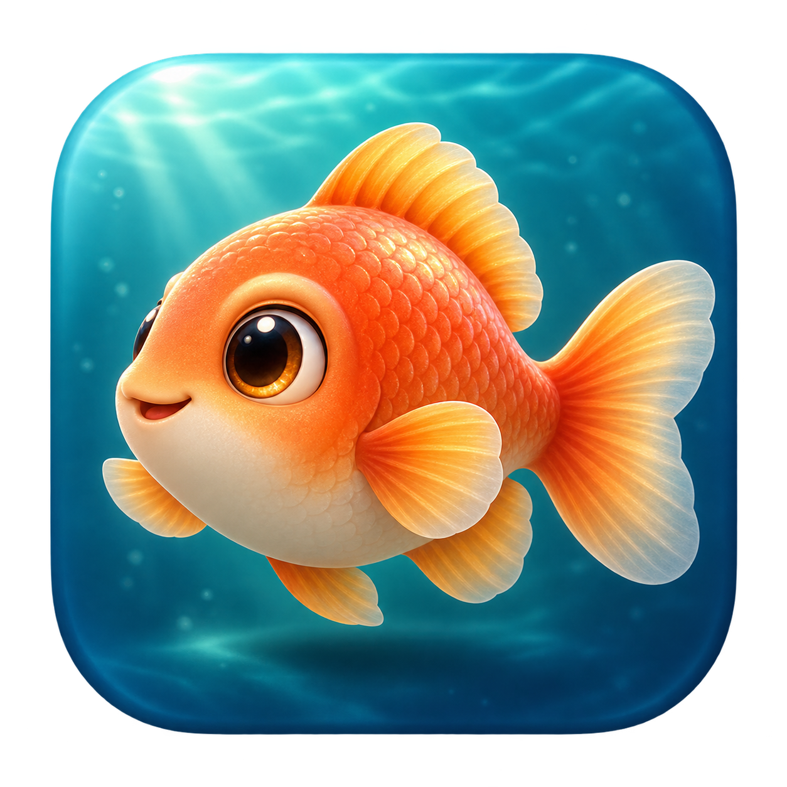
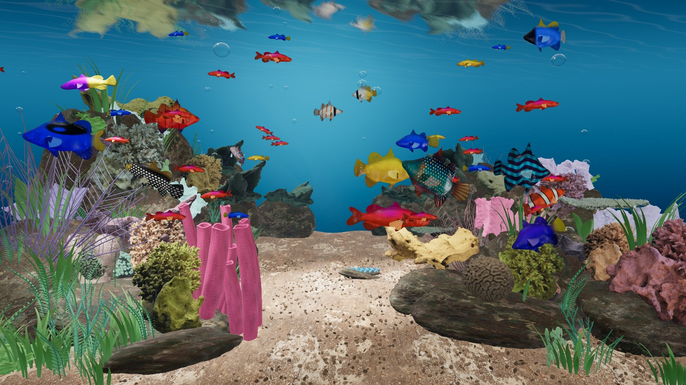
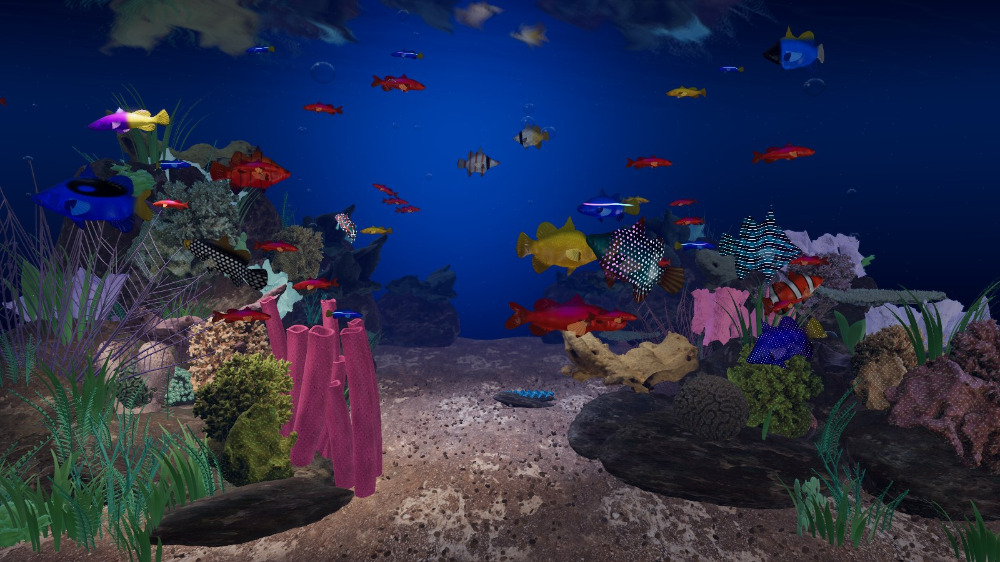
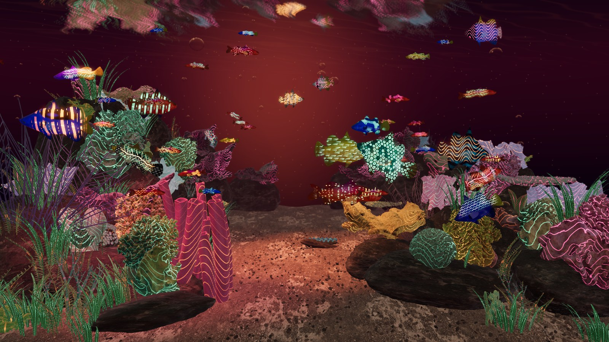

<p align="center"></p>

# Reef Live

An interactive 3D aquarium for your Mac desktop. Fish swim through a planted reef beneath your desktop icons and windows; click a fish, release bubbles or explore with a drag and a pinch.

[Download for Mac](https://github.com/hckmstrrahul/reef-live-mac-wallpaper/releases/latest) · [Setup and troubleshooting](docs/BUILDING.md) · [Build from source](#build-from-source)


Reef runs locally from the menu bar. Playback needs no account, subscription or internet connection.

## Install

Requires **macOS 14 Sonoma or later**. The published download targets **Apple silicon**; Intel builds are not validated.

1. Download the macOS arm64 ZIP from [Releases](https://github.com/hckmstrrahul/reef-live-mac-wallpaper/releases/latest), unzip it and move `Reef.app` to Applications.
2. Open Reef, click its menu-bar fish and choose **Start desktop wallpaper**.
3. Leave **Interact with desktop aquarium** enabled for desktop gestures.
4. Choose an appearance and start with **Balanced** quality.

The release is ad-hoc signed, not Apple-notarized. If macOS blocks it and you trust the download, follow [Apple's Open Anyway instructions](https://support.apple.com/en-us/102445).

**Stop desktop wallpaper** reveals your usual wallpaper. Closing the preview leaves the menu-bar app running; after quitting and reopening Reef, start the wallpaper again.

## Choose a world

| Daylight | UV Night | Planet X |
| --- | --- | --- |
|  |  |  |
| Clear blue water and bright reef colors. | Ultramarine water and fluorescent markings. | An alien sea with copper light and bioluminescence. |

These are captures from the running app. Choose a theme, follow macOS appearance, or use **Daily cycle**: Daylight from 7 AM–5 PM, Planet X from 5–9 PM and UV Night overnight, using your Mac's local clock.

## Controls and performance

| Control | Action |
| --- | --- |
| Click fish / scenery | Fish reaction / bubbles |
| Drag fish / empty water | Move a fish / pan |
| Scroll or pinch | Zoom |
| Right-drag or Option-drag in preview | Orbit |
| Escape / Reset view | Restore the composition |
| Space / H / D in preview | Pause / hide controls / rendering stats |

Each monitor renders its own aquarium. **High**, **Balanced** and **Eco** adjust quality; display sleep pauses animation. Apple silicon with 16 GB RAM or more is recommended, but only an M5 Max was benchmarked. Multiple large displays increase GPU work; try Balanced or Eco if playback slows or energy use is high. Desktop gestures and Spaces behavior can vary by macOS setup.

## Build from source

Requires **Node.js 22+**, npm and **Xcode Command Line Tools with Swift 6**. Blender is optional.

```sh
git clone https://github.com/hckmstrrahul/reef-live-mac-wallpaper.git
cd reef-live-mac-wallpaper
npm ci
npm run app
open build/Reef.app
```

The build bundles offline assets and applies a local ad-hoc signature. No paid Apple Developer membership is required. For browser development, `npm run dev` serves [127.0.0.1:4187](http://127.0.0.1:4187).

## How it works

Swift, AppKit and WKWebView manage menu-bar controls, desktop windows and gestures. Three.js and GLSL render the reef, swimming, plant motion and water effects. Fish share an anatomical model; species-inspired colors, fluid coupling and caustics are artistic approximations rather than a scientific simulation.

| Guide | Covers |
| --- | --- |
| [Building and troubleshooting](docs/BUILDING.md) | Native/browser development, tests and optional Blender export. |
| [Architecture](docs/ARCHITECTURE.md) | Rendering, native integration and performance. |
| [Asset provenance](docs/THIRD_PARTY.md) | Sources, modifications and licenses. |
| [Contributing](CONTRIBUTING.md) | Changes and bug reports. |

Implementation and testing were assisted by Codex. The app icon was made with OpenAI image generation; its [prompt and provenance](assets/icons/generation.json) are included.

## Credits, licensing and contributions


Reef’s original code is **[MIT licensed](LICENSE)**. Third-party code retains its MIT notices; the fish model, coral scans, textures and HDRI use CC0.

Thanks to [Three.js](https://threejs.org/), [threejs-water](https://github.com/jeantimex/threejs-water), [three-mesh-bvh](https://github.com/gkjohnson/three-mesh-bvh), [Microsoft / Khronos glTF Sample Assets](https://github.com/KhronosGroup/glTF-Sample-Assets/tree/main/Models/BarramundiFish), [Smithsonian Open Access](https://www.si.edu/openaccess) and [Poly Haven](https://polyhaven.com/).

**[Full asset sources, modifications and attributions →](docs/THIRD_PARTY.md)**

Ideas, bug reports, better fish anatomy, accessibility improvements and performance work are welcome. See [CONTRIBUTING.md](CONTRIBUTING.md) and [SECURITY.md](SECURITY.md).
